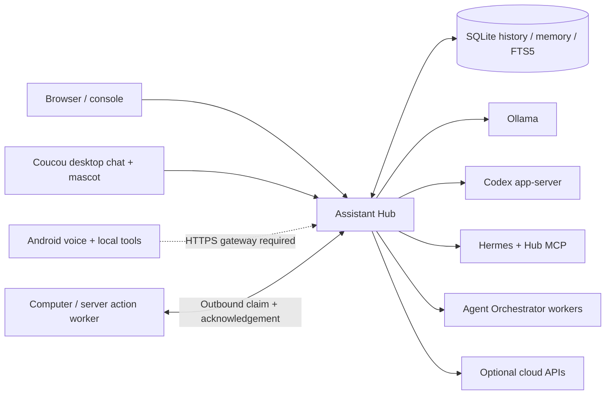

# Assistant Hub

A local, self-hosted coordinator for a personal assistant across desktop agents
and an Android companion. The Hub owns conversation topics, shared memory,
history, task state, node capabilities and notifications. Models and agent runtimes are adapters.

[Русский](README.ru.md) · [Android companion](https://github.com/weisscorp/android-assistant)



## What works

- Authenticated HTTP API and browser UI; separate topics and focus per client.
- Incoming webhooks, isolated incident assessment and durable phone/Coucou notification delivery.
- Named revocable API keys and an explicit public HTTPS origin behind a trusted reverse proxy.
- Shared node capability discovery and durable action queue with executor acknowledgements.
- Persistent Hub timers with direct model tools, topic notifications and completion in the Coucou mascot area.
- Optional computer worker and explicit private LAN/VPN listener address.
- Durable task queue: serial within a topic, concurrent across topics, cancellation,
  idempotent request IDs, and explicit unknown outcomes after a restart.
- Shared facts with revisions, topic-local facts, paginated history and agent session references.
- **Automatic indexed recall in code** before a model request: SQLite FTS5 selects
  matching facts instead of putting the entire knowledge base into a prompt.
- Memory tools that instruct agents to save durable user facts automatically.
  Actual saving still depends on a successful model tool call.
- Ollama, native Codex, official Hermes through MCP, and Agent Orchestrator adapters.
- Original Coucou connected through an OpenAI-compatible local provider facade
  and its Unix socket event interface. Coucou's code and mascot belong to its authors.
- Mobile knowledge snapshot/image sync and a polling notification inbox.
- OpenAI Responses, Anthropic Messages and OpenAI-compatible adapters, tested with
  protocol fixtures; paid providers are disabled until configured by the owner.

This is an early development release. It does not yet provide unrestricted control
of a device fleet, automatic ingestion of every existing agent chat, or a complete
server-to-phone tool execution loop. Android needs an authenticated HTTPS gateway;
the Hub defaults to loopback and can explicitly bind a private/VPN interface.
See [architecture and limits](docs/architecture.md).

## Quick start

Python 3.11+ with SQLite FTS5 is enough for the core Hub. Install [Ollama](https://github.com/ollama/ollama)
separately. macOS/Linux are the supported launcher targets.

```sh
git clone https://github.com/weisscorp/assistant-hub.git
cd assistant-hub
ollama pull qwen3:4b-instruct-2507-q4_K_M
# Run ollama serve in another terminal if its service is not already running.
python3 tools/local_stack.py setup
python3 tools/local_stack.py start
python3 tools/local_stack.py open
python3 tools/local_stack.py ask --provider ollama 'Привет'
python3 tools/local_stack.py status
```

`open` creates a one-use login ticket. Runtime configuration, credentials, logs and
SQLite state live outside the checkout in `~/.local/share/assistant-stack`.
Stop owned Hub/worker processes with `python3 tools/local_stack.py stop`; it does
not stop your existing Ollama service. The launcher does not install phone apps.

Change the Ollama model/URL in the **private** generated `config.json`, then stop/start
Hub. A small instruct model supporting tools is a useful starting point; model
quality and latency depend on the hardware and task. No weights are distributed here.

## Connect components

- [Coucou, Codex, Hermes, Agent Orchestrator and cloud setup](docs/integrations.md)
- [Shared memory, indexed search and history](docs/memory.md)
- [Connected nodes, actions, timers and VPN transport](docs/capabilities.md)
- [Android connection contract and current gaps](docs/android.md)
- [API and extending providers](docs/api.md)
- [API keys and Internet access through HAProxy](docs/internet-access.md)
- [Webhook incidents and notifications](docs/webhooks.md)
- [Security, private state and backups](SECURITY.md)
- [Third-party credits and licenses](THIRD_PARTY.md)

Desktop UI text and the initial voice companion are primarily Russian. Protocol
fields and the documentation use English so the components can be reused.

## Development

```sh
python3 -m unittest discover -s backend -p 'test_*.py' -q
python3 tools/benchmark_knowledge.py --facts 50000 --repetitions 80
```

The tests use synthetic data and temporary databases, not an owner's running
stack. Optional MCP dependencies are pinned in `backend/requirements-mcp.txt`.
The `backend/` directory also retains earlier HTTPS phone-bridge, isolated build
job and release-staging modules; they are separate from the default Hub launcher
and are not a production OTA delivery service.

## License

Our source and documentation are [MIT](LICENSE). External applications, libraries,
model weights and service data retain their own licenses. In particular, this
project is an integration with [Coucou by Louis Raillé](https://github.com/Louis-CFM/coucou),
[Hermes by Nous Research](https://github.com/NousResearch/hermes-agent) and
[Agent Orchestrator](https://github.com/OrchestratorInc/agent-orchestrator), not a
relicensing or rebundling of those projects.
