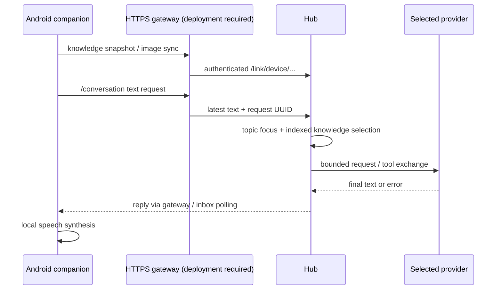

# Android companion connection

The separate [Android source repository](https://github.com/weisscorp/android-assistant)
provides local capture, recognition, synthesis, models, device tools and knowledge
storage. This repository provides its server-side conversation/link endpoints.

## Network boundary

Hub defaults to HTTP on `127.0.0.1` and can explicitly bind a private/VPN IP;
the Android client accepts **HTTPS** endpoints.
Changing an IP in the app cannot make loopback accessible. A separately deployed
TLS gateway must proxy `/conversation` and `/link/...` to Hub, supply an allowed
upstream Host, preserve Authorization and support the needed body limits. This
publication does not deploy such a gateway or expose the Hub to the Internet.

The app can use system-trusted HTTPS or its explicit private-LAN certificate
pinning mode. For the latter, configure a certificate with the endpoint IP in
its SAN and enter its SHA-256 certificate fingerprint through a trusted channel.
Pinning does not skip expiry/hostname validation; there is no trust-on-first-use.
Issue a separate [revocable client key](internet-access.md) for the phone.
The Hub's token is supplied through the app's settings and stored using Android
protected credential handling. Treat every token holder as trusted.

## What sync means today

The phone is authoritative for source recipes, aliases, saved people and captured
observations. Full revisioned snapshots and images go to HomeLinkStore. Hub shared
memory contains discoverable references; `phone_knowledge` retrieves details.
An old saved observation is not a live person's location. User-specific sources
belong in the database; no school, family, chat or site is hardcoded in the app.

The Android client has a per-client Hub topic focus. The current `/conversation`
adapter submits the latest text; it validates but does not yet forward all phone
history/capabilities or execute returned server tool actions (`action` is null).
This is not yet full cross-device action orchestration.

Phone inbox delivery uses polling and Android scheduling, so background/Doze
may delay messages. It is not FCM push. There are server notification primitives,
but Slack/mail monitoring is not connected by default. End-to-end phone pairing
through a new gateway must be verified separately; no physical device is contacted
by repository setup, tests or CI.

## Private Tailscale connection

Run the central Hub on the always-on NAS (or another explicitly selected host),
and use Tailscale Serve (not Funnel) as the clients' HTTPS gateway. For a Hub
on the same host and bound to loopback, `tailscale serve --bg --https=8443 http://127.0.0.1:8778`
creates an endpoint available to the tailnet. Set the private Hub configuration's
`public_url` to the exact `https://HOST.TAILNET.ts.net:8443` origin and
`trusted_proxies` to `127.0.0.1/32` and `::1/128`, then restart an idle Hub.
The setting is the HTTPS proxy origin; it does not itself publish an Internet
listener. Verify Serve's configuration has no Funnel allowance.

Issue a separate revocable API key for the phone. In Android settings → Hermes,
enter the Tailscale HTTPS URL and key; leave the certificate fingerprint empty
because Tailscale Serve uses a system-trusted certificate. Enable synchronization
and choose Hermes for server questions. The VPN must be connected on the phone;
there is no LAN or public-endpoint fallback. Android stores the key encrypted.

After the phone's first knowledge sync, use its actual device UUID to set the
`android:DEVICE_UUID` client focus to Coucou's selected topic with the normal
revision-checked focus API. This gives both clients the same topic history and
lets replies in that topic reach the paired phone inbox. Client focus can change
independently afterwards. This setup does not grant either client arbitrary
remote device control. Do not record or play audio to verify configuration.

For TrueNAS containers, proxy to the NAS VPN address and Hub port instead of
loopback when loopback is not reachable from the Tailscale container. Trust only
the exact proxy source addresses observed by Hub. Coucou uses the same HTTPS
origin, with its own revocable key in macOS Keychain. Do not route clients
through a laptop when the central Hub is on the NAS.

A Hermes API on the same NAS can be connected using `backend/hub_hermes_api.py`
as a command provider. Its private configuration contains `url` ending in `/v1`,
`key_file` pointing to an owner-only mode-600 file, and `model: hermes-agent`.
Pass the existing Hermes `API_SERVER_KEY`; do not substitute the Hub client key.
The adapter permits HTTP only to an explicit private IP, while remote clients
continue to use VPN HTTPS. Verify Hermes's own `model.base_url` reaches Ollama
from its container; an obsolete LAN address can leave the API healthy while
every completion times out. Back up configuration before changing that address.
