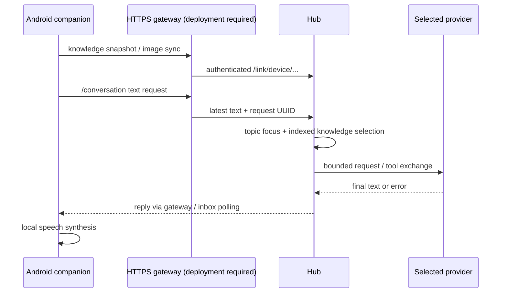

# Android companion connection

The separate [Android source repository](https://github.com/weisscorp/android-assistant)
provides local capture, recognition, synthesis, models, device tools and knowledge
storage. This repository provides its server-side conversation/link endpoints.

## Network boundary

Hub binds HTTP only on `127.0.0.1`; the Android client accepts **HTTPS** endpoints.
Changing an IP in the app cannot make loopback accessible. A separately deployed
TLS gateway must proxy `/conversation` and `/link/...` to Hub, supply an allowed
upstream Host, preserve Authorization and support the needed body limits. This
publication does not deploy such a gateway or expose the Hub to the Internet.

The app can use system-trusted HTTPS or its explicit private-LAN certificate
pinning mode. For the latter, configure a certificate with the endpoint IP in
its SAN and enter its SHA-256 certificate fingerprint through a trusted channel.
Pinning does not skip expiry/hostname validation; there is no trust-on-first-use.
The Hub's token is supplied through the app's settings and stored using Android
protected credential handling. Treat every token holder as trusted.

## What sync means today

The phone is authoritative for source recipes, aliases, saved people and captured
observations. Full revisioned snapshots and images go to HomeLinkStore. Hub shared
memory contains discoverable references; `phone_knowledge` retrieves details.
An old saved observation is not a live person's location. User-specific sources
belong in the database; no school, family, chat or site is hardcoded in the app.

The Android client has a per-client Hub topic focus. The current `/conversation`
adapter submits the latest text; it validates but does not yet forward all phone
history/capabilities or execute returned server tool actions (`action` is null).
This is not yet full cross-device action orchestration.

Phone inbox delivery uses polling and Android scheduling, so background/Doze
may delay messages. It is not FCM push. There are server notification primitives,
but Slack/mail monitoring is not connected by default. End-to-end phone pairing
through a new gateway must be verified separately; no physical device is contacted
by repository setup, tests or CI.
